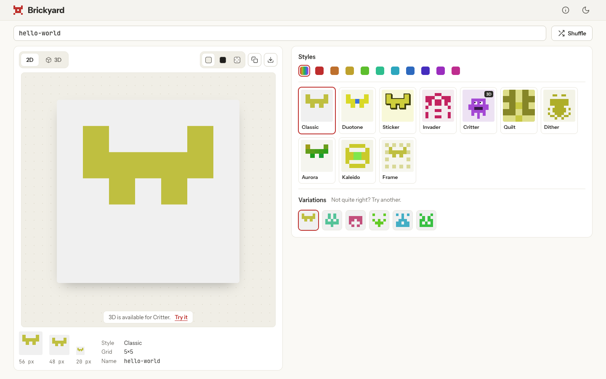

# Brickyard

Pixel avatars from any name, in ten styles, with a 3D Critter view. Same name, same face.

**Live demo:** https://brickyard.surge.sh



## Features

- Ten styles: Classic, Duotone, Sticker, Invader, Critter, Quilt, Dither, Aurora, Kaleido and Frame.
- Colour (Auto or one of ten hues) and Background (Light, Dark or Transparent).
- Copy PNG to the clipboard, or download a PNG at 512, 1024 or 2048 px.
- A 3D view for Critter, built from blocks: rotate, zoom, four angle presets and Reset view.
- Light and dark app appearance, with a toggle in the top bar.
- A single-screen phone layout with Style, Variations and Colour tabs.
- An About dialog that explains how it works.

## How it works

The name is hashed into one 32-bit number, which seeds a random number generator. Because the generator is seeded, it gives the same sequence every time, so the same name always gives the same avatar. Each style adds its own salt, then uses the sequence to fill the left half of its grid; the right half mirrors it, which is what makes the blocks read as a face or a creature. The colour comes from the same numbers, within fixed brightness and saturation ranges, and a chosen colour overrides the hue only. Changing the colour, background or view never changes which cells are filled. The full picture is in [docs/ARCHITECTURE.md](docs/ARCHITECTURE.md).

## Tech stack

- Vite, React and TypeScript (strict)
- three.js through @react-three/fiber and @react-three/drei, for the 3D view only
- Plain CSS with CSS variables for light and dark
- Vitest for unit tests, Playwright for end-to-end checks and screenshots
- No backend: it is a static site

## Run it

Needs Node 20 or newer.

```sh
npm install
npm run dev        # start the dev server
npm run build      # production build into dist/
npm test           # unit tests
```

`npm run typecheck` runs the TypeScript check. For the end-to-end checks, run `npx playwright install chromium` once, then `npm run build` and `npm run verify:ui`; it saves screenshots to `docs/screenshots/`.

## Deploy

```sh
npm run deploy     # builds, then publishes dist/ to brickyard.surge.sh
```

Needs `npx surge login` once on the machine. `public/CNAME` holds the domain, so every deploy goes to the same address.

## Docs

- [docs/REQUIREMENTS.md](docs/REQUIREMENTS.md): what the app does
- [docs/TASKS.md](docs/TASKS.md): the build plan, decisions and stage reports
- [docs/ARCHITECTURE.md](docs/ARCHITECTURE.md): how it is built

## Later

SVG and STL download, 3D for more styles, and animation.

## Licence

MIT. See [LICENSE](LICENSE).
